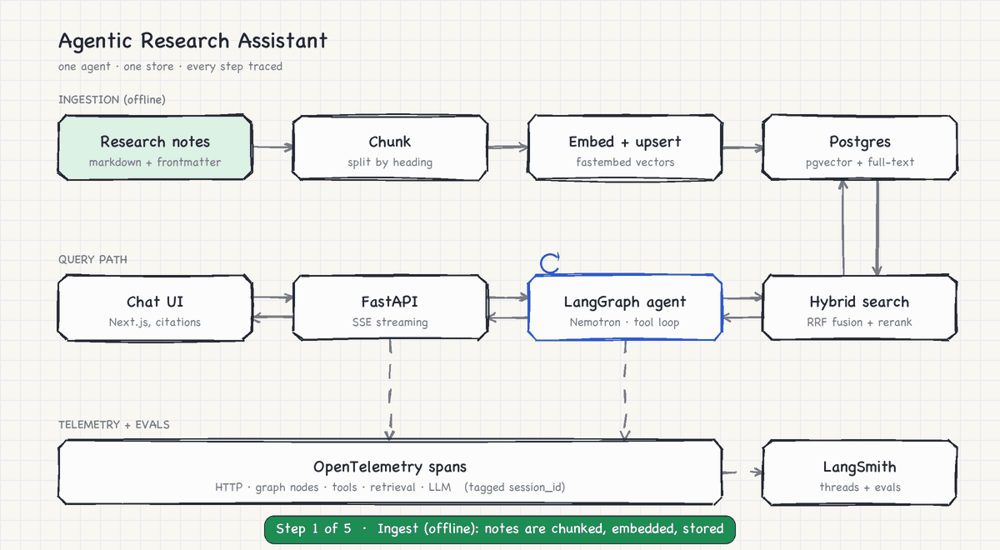
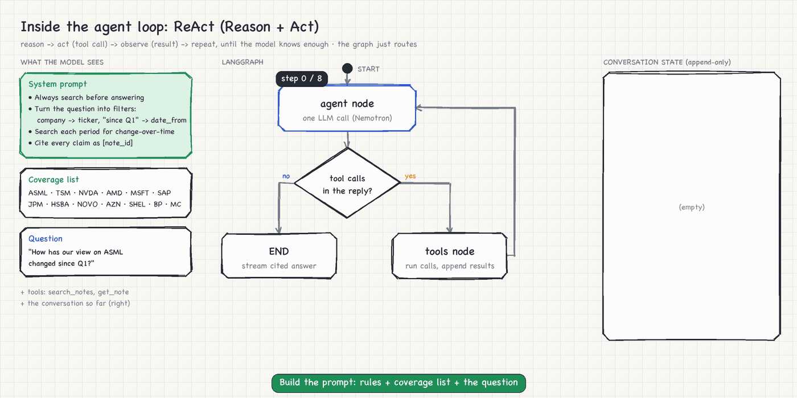

<p align="center">
  
</p>

# Agentic Research Assistant

Ask questions of a library of equity research notes and get answers where every claim is cited
back to a source note.

A single **LangGraph agent** decides how to search. It's an LLM in a tool loop: by default a free
NVIDIA Nemotron model via **OpenRouter**. It sits behind a **FastAPI** streaming API, searches a **Postgres + pgvector** store with **hybrid search and a
reranker**, and answers in a small **Next.js** chat UI with a citations panel. Every step is traced
with **OpenTelemetry** and exported to **LangSmith**, and an **offline eval suite gates CI**.

The design keeps the moving parts few enough to explain on a whiteboard while still covering
what matters in production RAG: retrieval quality, grounding, observability and evaluation.
Full rationale: [Reference Architecture (PDF)](Agentic%20Research%20Assistant%20Reference%20Architecture.pdf).
One deliberate change from that document: the model runs through OpenRouter (a free NVIDIA
Nemotron model by default) instead of the Anthropic API, so the project needs no paid key.

## What makes it agentic

An agent that calls search once is RAG with extra latency. This one has two tools and questions
that need a loop:

| Tool | Purpose |
|---|---|
| `search_notes(query, ticker?, sector?, date_from?, date_to?)` | Hybrid search. The model pulls filters out of the question ("ASML since Q1" → `ticker=ASML, date_from=2026-01-01`). Filters run in SQL before ranking, so they can't be "forgotten". |
| `get_note(note_id)` | Read a full note when a chunk isn't enough. |

So a question like *"How has our view on ASML changed since Q1?"* becomes several filtered
searches across time periods, followed by a comparison of ratings and price targets, with each
claim cited as `[asml-2026-04-16]`.

<p align="center">
  
</p>

**This is a ReAct loop** (Reason + Act, [Yao et al., 2022](https://arxiv.org/abs/2210.03629)).
Each turn the model *reasons* about what it still needs, *acts* by calling a tool, and *observes*
the result, which is appended to the conversation before the next turn. The implementation is the
modern form of the pattern, with three differences from the paper:

| | ReAct as published | This agent |
|---|---|---|
| Acting | The model writes `Action: search[...]` as text, which code parses | Native tool calling: a structured, schema-checked call, nothing to parse |
| Reasoning | `Thought:` lines written into the transcript | The model reasons internally; the conversation state keeps only actions, observations and the answer |
| Finishing | The model writes `Action: finish[answer]` | The model replies with no tool calls |

It also allows several tool calls per turn, run in parallel.

**Who decides when to stop?** The model does. Each turn it either replies with tool calls
(meaning "I need more") or without them (meaning "I can answer"). The graph never judges whether
the evidence is sufficient. It routes mechanically on whether the reply contains tool calls
(`route_after_agent` in [`agent.py`](backend/app/agent.py)). The one exception is the budget:
after `MAX_AGENT_STEPS` (8) the graph adds an "answer now" note and stops routing to tools. The
trajectory eval checks the model chose the right tools and filters along the way.

## How it works

| Layer | Choice | Where |
|---|---|---|
| Ingestion | Markdown + frontmatter → split by heading → local embeddings (fastembed, `bge-small`) → Postgres. Idempotent by content hash. | [`backend/app/ingest.py`](backend/app/ingest.py) |
| Store | Postgres 17 + pgvector: HNSW vectors, a generated `tsvector` for full-text, and SQL metadata filters, all in one container | [`backend/app/db.py`](backend/app/db.py) |
| Retrieval | Dense + full-text legs → Reciprocal Rank Fusion → cross-encoder rerank (local by default, Cohere optional) | [`backend/app/retrieval.py`](backend/app/retrieval.py) |
| Agent | LangGraph `agent ⇄ tools` graph. History is append-only, parallel tool calls run concurrently, and a step budget caps the loop. | [`backend/app/agent.py`](backend/app/agent.py) |
| LLM | OpenRouter's OpenAI-compatible API, with streaming tool calls. Default `nvidia/nemotron-3-super-120b-a12b:free`; any OpenRouter model with tool calling works | [`backend/app/llm.py`](backend/app/llm.py) |
| API | FastAPI + SSE events: `run`, `tool_call`, `tool_result`, `sources`, `text`, `done`, plus `POST /feedback` | [`backend/app/main.py`](backend/app/main.py) |
| UI | Next.js + Vercel AI SDK (`useChat`). A route handler converts the API's SSE into AI SDK message parts. | [`frontend/`](frontend) |
| Tracing | OTel SDK → LangSmith's OTLP endpoint (or any OTLP backend). Spans cover HTTP, graph nodes, LLM calls, tools and retrieval. Traces are tagged with `session_id`, so LangSmith groups each conversation as a thread. | [`backend/app/telemetry.py`](backend/app/telemetry.py) |
| Evals | 50 synthetic notes, 30 graded questions, scored on four levels (below) and gated in GitHub Actions | [`backend/evals/`](backend/evals) |

### Evaluation

| Level | What it checks | How | Runs |
|---|---|---|---|
| Retrieval | recall@5, MRR against gold note ids | Deterministic, no LLM | Every CI build |
| Answer | Correctness vs a reference answer; groundedness (every claim supported by a cited note) | LLM as judge (`OPENROUTER_JUDGE_MODEL`), structured output | CI when `OPENROUTER_API_KEY` is set |
| Trajectory | Right tools called, right filters extracted | Tool calls compared against the expected trajectory | CI when `OPENROUTER_API_KEY` is set |
| Online | Thumbs up/down in the UI | Stored in Postgres and written as LangSmith feedback on that trace | Live |

Thresholds live in [`backend/evals/thresholds.json`](backend/evals/thresholds.json). A run scoring
below any threshold exits non-zero, which is what turns it into a release gate.

## Quick start (Docker)

You need Docker and an [OpenRouter key](https://openrouter.ai/settings/keys). The default model is
NVIDIA Nemotron 3 Super (`nvidia/nemotron-3-super-120b-a12b:free`), which supports the tool calling
and structured output this app needs, at no per-token cost.

- Without credits, free models allow **50 requests a day**: enough to try the app and run
  `make eval-local`.
- A one-off **$10 credit purchase** raises that to **1,000 a day**, enough for the full eval.

A LangSmith key is optional.

```bash
cp .env.example .env
```

Set `OPENROUTER_API_KEY` in `.env`, plus `LANGSMITH_API_KEY` if you want traces. Then:

```bash
docker compose up --build
```

Open <http://localhost:3000>. Compose starts Postgres, runs the one-shot ingest job, then starts
the API (<http://localhost:8000>) and the web UI. The first build downloads the local
embedding and reranker models (~150 MB), cached in a Docker volume.

## Run locally and validate it works

Prerequisites: Docker (for Postgres), [uv](https://docs.astral.sh/uv/), and Node 20+.
`make help` lists every target.

**1. Install and check everything that doesn't need an API key.**

```bash
make setup
```

```bash
make validate
```

`validate` starts Postgres, ingests the notes, then runs:

- the unit and integration tests, which drive the real graph, tools, database and SSE
  endpoint with the model's streamed responses scripted (no key needed);
- the retrieval eval gate;
- the frontend typecheck.

Expected output ends with `retrieval gate passed` and `Offline checks passed`.

**2. Check the live agent.** Put `OPENROUTER_API_KEY` in `.env`, then in one terminal:

```bash
make api
```

and in another:

```bash
make smoke
```

`smoke` checks `/health` (which shows the active model), asks a real question, and
passes only if the stream finishes with a cited answer and at least one tool call. It prints the
answer, the citations and the filters the agent extracted.

**3. Use the UI.**

```bash
make web
```

Open <http://localhost:3000> and try a suggested question. You should see:

- tool pills showing the extracted filters (`ticker=ASML`, `date_from=…`);
- a streamed answer with clickable citation chips;
- the cited notes highlighted in the sources panel.

Thumbs up/down is stored in the `feedback` table, and in LangSmith if you set a key.

**4. Run the agent eval.**

```bash
make eval-local
```

This scores five questions locally, which is quick and cheap. `make eval` runs all 30 questions
and, with `LANGSMITH_API_KEY` set, uploads them as a LangSmith experiment against the dataset
`research-assistant-golden`.

> **On OpenRouter's free models**, the limits are 20 requests/minute and **50 requests/day**, or
> **1,000/day once you've bought $10 of credits**. A question takes about 4 requests when
> evaluated (agent turns plus judges). Without credits, `make eval-local` (about 20 requests) fits
> in a day but the full `make eval` (about 120) doesn't. With credits, both fit easily.
>
> The eval checks your remaining quota before it starts. If there isn't enough, it stops with a
> message telling you to use a smaller `--limit` or wait for the reset at 00:00 UTC. It won't
> retry into the limit. The client retries per-minute 429s automatically, and the UI explains
> when you've hit the limit.

If you switch to a different model, it may score differently and fail the gate. That's the gate
doing its job, but you can tune [`thresholds.json`](backend/evals/thresholds.json) per model.

**5. Check the traces (optional).** With `LANGSMITH_API_KEY` set, open the
`research-assistant` project in LangSmith. Each question is one trace (HTTP → chat → agent
steps → `openrouter.chat` / `tool.search_notes` → `hybrid_search` → dense/sparse/rerank), and
**Threads** groups them by chat session.

## Configuration

All settings are environment variables. See [`.env.example`](.env.example) and
[`backend/app/config.py`](backend/app/config.py).

| Variable | Default | Notes |
|---|---|---|
| `OPENROUTER_API_KEY` | none | Required |
| `OPENROUTER_MODEL` / `OPENROUTER_JUDGE_MODEL` | `nvidia/nemotron-3-super-120b-a12b:free` | Any OpenRouter model that supports tool calling (and structured outputs, for the judge). Other free NVIDIA options: `nvidia/nemotron-3-ultra-550b-a55b:free`, `nvidia/nemotron-3.5-lightning:free` |
| `LANGSMITH_API_KEY` / `LANGSMITH_PROJECT` | none / `research-assistant` | Enables OTLP export, LangSmith experiments and feedback |
| `OTEL_EXPORTER_OTLP_TRACES_ENDPOINT` | none | Send traces to Phoenix, Datadog, a collector, … instead |
| `RERANKER` | `local` | `local`, `cohere` (needs `COHERE_API_KEY`), or `none` |
| `TOP_K` / `MAX_AGENT_STEPS` | `8` / `8` | Chunks per search / tool-loop budget |

## Project layout

```
backend/
  app/            ingest, retrieval, rerank, tools, agent (LangGraph), llm (OpenRouter), telemetry, FastAPI
  evals/          dataset.jsonl (30 questions), metrics, LLM judges, runners, thresholds
  scripts/        generate_notes.py (corpus), render_*_gif.py (the two GIFs; `make gif`)
  tests/          unit tests + integration tests with a scripted model stream
frontend/         Next.js app: chat page, /api/chat SSE → AI SDK bridge, /api/feedback
data/notes/       50 synthetic research notes (markdown + frontmatter)
scripts/smoke.sh  live smoke test against a running API
.github/workflows/ci.yml   tests + retrieval gate on every build; agent eval gate with secrets
```

## Data

The notes in `data/notes/` are **synthetic**: fictional figures written for this demo, not real
research or investment advice. Regenerate them with
`backend/.venv/bin/python backend/scripts/generate_notes.py`. To use your own notes, drop
markdown files with the same frontmatter fields into `data/notes/` and run `make ingest`.

## Later (not in the MVP)

- **Entitlement filtering per user.** Research distribution and MNPI controls belong in the
  retrieval SQL filter, next to ticker and date, not in the prompt.
- Online evals on production traces.
- Query rewriting.
- Semantic caching.
- Amazon Bedrock as a second LLM backend in `app/llm.py`, for an AWS-shaped deployment.
